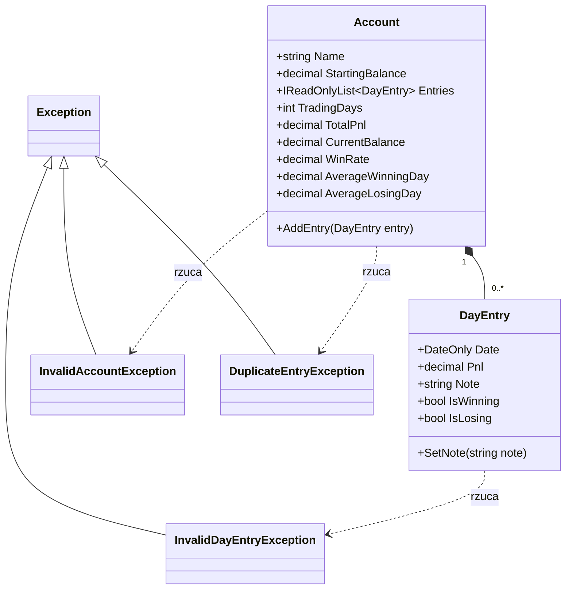

# Trade Journal

Dziennik tradera: kalendarz dziennego PnL, statystyki i śledzenie reguł kont fundowanych.

> Status: wersja w budowie (projekt zaliczeniowy).


## Funkcje

Zrobione:
- wpis dnia handlowego (`DayEntry`): data, PnL, notatka, walidacja danych
- konto (`Account`): lista wpisów dni, unikalność dat, PnL, saldo, win rate, średni wygrany i przegrany dzień

Planowane do v1.0.0:
- kalendarz dziennego PnL
- pozostałe statystyki: profit factor, drawdown, equity curve
- załączniki: obrazy (Ctrl+V) i linki TradingView
- silnik reguł prop firm (preset Topstep + własne reguły)

## Technologia

C# (.NET 10), ASP.NET Core Razor Pages, SQLite (od v0.2.0), xUnit, GitHub Actions.

## Struktura

```
src/TradeJournal.Core     logika domenowa (bez zależności od strony)
src/TradeJournal.Web      aplikacja webowa (Razor Pages)
tests/TradeJournal.Tests  testy jednostkowe (xUnit)
```

## Budowanie i testy

Wymagany .NET SDK 10. W katalogu głównym repozytorium:

```
dotnet build
dotnet test
```

Testy uruchamiają się też automatycznie na GitHubie przy każdym pushu do `main`.

## Uruchomienie

```
dotnet run --project src/TradeJournal.Web
```

## Wydania

Gotowe paczki są w zakładce [Releases](https://github.com/Patrykjac/trade_journal/releases). Każde wydanie powstaje automatycznie po wypchnięciu tagu `vX.Y.Z` (GitHub Actions: testy, publikacja, ZIP z numerem wersji).

Platforma: Windows x64, paczka samodzielna (nie wymaga instalacji .NET).

Uruchomienie z paczki: rozpakuj ZIP, uruchom `TradeJournal.Web.exe` i otwórz adres wyświetlony w terminalu (zwykle `http://localhost:5000`).

## Diagram klas



## Koncepcje obiektowe

| Koncepcja | Klasy i pliki | Uzasadnienie |
|---|---|---|
| Hermetyzacja | `DayEntry.cs`, `Account.cs` | stan zmienia się tylko przez kontrolowane metody; lista wpisów konta jest prywatna i wystawiona tylko do odczytu |
| Obsługa błędów | `InvalidDayEntryException.cs`, `InvalidAccountException.cs`, `DuplicateEntryException.cs` | jawne, własne sygnalizowanie niepoprawnych danych |
| Kompozycja | `Account.cs` (zawiera obiekty `DayEntry`) | konto składa się z wpisów dni |

## Rejestr użycia LLM

| Plik / fragment | Narzędzie | Do czego użyto i jak zweryfikowano |
|---|---|---|
| `.gitignore` | Claude | doradztwo (polecenie `dotnet new gitignore`), plik wygenerowany przez dotnet |
| `.gitattributes` | Claude | doradztwo , plik napisany według podpowiedzi |
| plik `.slnx`, projekty Core/Web/Tests | Claude | doradztwo (podział na projekty), pliki wygenerowane szablonami `dotnet new` |
| `InvalidDayEntryException.cs` | Claude | wygenerowany |
| `DayEntry.cs` | Claude | wygenerowany; zweryfikowany testami |
| `DayEntryTests.cs` | Claude | wygenerowany |
| `InvalidAccountException.cs` | Claude | wygenerowany, poprawiono ręcznie|
| `DuplicateEntryException.cs` | Claude | wygenerowany, użyty bez zmian |
| `Account.cs` | Claude | wygenerowany, użyty bez zmian; zweryfikowany testami |
| `AccountTests.cs` | Claude | wygenerowany, użyty bez zmian |
| `.github/workflows/ci.yml` | Claude | wygenerowany, użyty bez zmian; zweryfikowany przebiegiem w GitHub Actions |
| `README.md` | Claude | szkielet i tabele przygotowane z pomocą LLM, wklejone i dopasowane ręcznie |

Uwaga: commity `a23e4bc` i `4c9c76b` zawierały pliki z błędami składni, poprawione w kolejnych commitach (`1e3b018` i `c6f217b`). Stopki tych commitów nie wspominają o ręcznej poprawce, dlatego opisano ją w rejestrze powyżej.